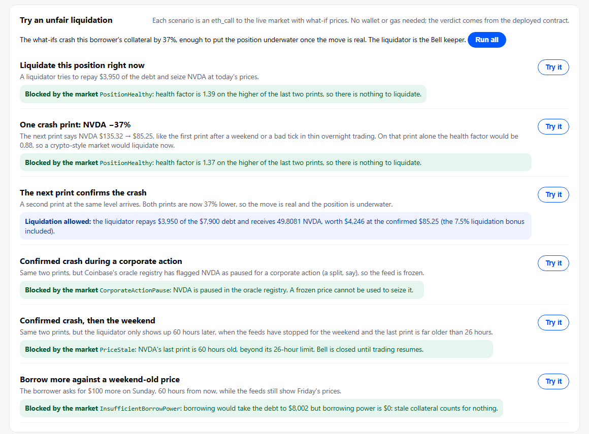
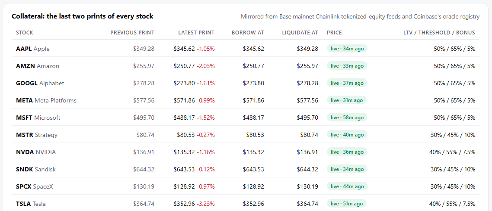

# Bell

**Borrow against tokenized stocks on Base, with liquidations that respect the closing bell.**

Crypto lending markets assume prices that move every second of every day. Stocks don't. Their Chainlink feeds follow
the 24/5 trading week: they stop over weekends and holidays, freeze during corporate actions, and print thin overnight
and pre-market sessions before the regular open. Plug a tokenized stock into a crypto-style lending market and it will
happily liquidate someone on a single print after the weekend, or lend against Friday's close until Monday.

Bell is a lending market for [Coinbase tokenized stocks on Base](https://docs.base.org/build-on-base/integrate-defi/list-tokenized-stocks)
that keeps stock-market hours. Lenders supply USD; borrowers post tokenized stocks as collateral and borrow USD against
them; a keeper liquidates positions that are really underwater. The difference is in what counts as "really":

| Rule (enforced by `BellMarket`) | What it stops |
| --- | --- |
| **Two-print pricing.** The market remembers the last two feed rounds it has seen for every stock. Borrowing power uses the *lower* print; liquidations use the *higher* one. | A single print (an opening gap, a bad tick) liquidating anyone. The next print has to confirm the move first. |
| **Frozen means frozen.** A stock whose price is older than its `maxPriceAge`, or that Coinbase's oracle registry flags as paused for a corporate action, gives *zero* borrowing power and *cannot be seized*. It still counts toward health at its higher print. | Borrowing against a stale Friday close over the weekend, and liquidations triggered by a freeze, a split or a halted feed. |
| **Total-return prices.** Positions are valued as raw B20 balance x the Chainlink total-return price (price x multiplier). | Splits and reinvested dividends moving a position's value. |
| **Close factor 50%, tiered risk.** At most half the debt per liquidation; bigger haircuts and bonuses for more volatile names. | Wiping a borrower out in one step; one-size-fits-all risk. |

- **App:** https://superphant.github.io/bell/
- **Demo video (2 min):** [bell_demo.mp4](https://github.com/SuperPhant/bell/releases/download/demo-v1/bell_demo.mp4)
- **Keeper runs and market status:** [`notes` branch](https://github.com/SuperPhant/bell/tree/notes)
- **Contracts and addresses:** [`deployments/`](deployments)
- Built for the [Base Stocks Maxxing](https://www.base.org/stocksmaxxing) builder quest, Programmable Stock Markets
  track (a financing tool and market infrastructure for tokenized stocks).

### Try it in two minutes

1. Open the app. Under **Borrowers**, press **Try to liquidate** next to the NVDA borrower, then **Run all**. Each
   scenario is an `eth_call` to the live market with what-if state (a new print on the price mirror, the market's record
   of prints, the oracle registry's pause flag, a later block time), so the verdicts come from the deployed contract. No
   wallet or gas needed.
2. To borrow yourself, open **Borrow & lend** and connect a wallet. The app runs on Base Sepolia; the menu at the top
   switches to Base Vibenet, where **Get test ETH (gas)** is one click (no captcha, no sign-up). On either chain press
   **Get 10,000 tUSD**, buy a test stock at its Chainlink price, press **Deposit all**, then **Borrow**. Or supply test
   USD to the pool and earn the interest.



> Testnet demonstration. Test tokens mirror Coinbase tokenized stocks on Base mainnet; they have no value, are not
> securities and are not issued by Coinbase. Nothing here is an offer to lend or borrow, or investment advice.
> Coinbase tokenized stocks are not available to US persons, and Bell is not offered to US persons.

## Why two prints

Liquidations are irreversible, and a stock price is only meaningful while its market is open. Bell asks for the same
evidence a human risk desk would: one print is a claim, two prints are a price.

- **Weekend gap.** Say NVDA's last print before the weekend is $137 and the first print when trading resumes says $82
  (-40%). A crypto market liquidates every NVDA borrower right there. In Bell the liquidation price is still the higher
  print, $137, so nothing happens. If the next print confirms $82, both prints are low and liquidations go ahead, now
  on a confirmed price.
- **Weekend.** The feeds stop from Friday evening until trading resumes on Sunday evening (New York time). Once a
  stock's last print is more than 26 hours old (the feeds' 24-hour heartbeat plus two hours of grace), nobody can
  borrow against it and nobody can be liquidated through it. Repaying and adding collateral still work. Bell reopens
  with the market.
- **Corporate action.** During a corporate action Coinbase sets the pause flag in its oracle registry and the feed
  holds its last value. Bell reads the flag directly: it stops lending against the stock and refuses to seize it until
  the flag is cleared, without waiting for the price to go stale. The Base docs put it plainly: *never settle or
  liquidate against a frozen feed.*

The cost of waiting one print is bounded: borrowing power always uses the *lower* print, and the liquidation threshold
sits 15 percentage points above the LTV, so a position opened at the maximum LTV has a buffer that covers a confirmed
move of about 23% (megacaps) before it is underwater.

## What happens in practice

- **Last weekend on Base mainnet.** The Chainlink feeds for NVDA, TSLA and AAPL printed for the last time on Friday
  2026-11-13 between 21:05 and 23:36 UTC and resumed at 01:00 UTC on Monday 11-16 (8 pm Sunday in New York): a gap of
  49 to 52 hours. Bell treats each stock as closed once its last print is 26 hours old, and the first print after the
  gap is exactly the single print it will not liquidate on.
- **A down day, live.** On 2026-11-20 every stock's latest print came in 0.1% to 3.2% below the previous one. Borrowing
  power follows the lower prints and liquidation prices stay at the higher ones (screenshot below). The NVDA demo
  borrower's borrowing power fell to $7,899, just under its $7,900 debt: it cannot borrow more or withdraw collateral,
  yet its health factor is 1.39, far from liquidation.



## Risk parameters (live deployment)

| Stocks | Max LTV | Liquidation threshold | Liquidation bonus | Max price age |
| --- | --- | --- | --- | --- |
| AAPL, AMZN, GOOGL, META, MSFT | 50% | 65% | 5% | 26 h |
| NVDA, TSLA | 40% | 55% | 7.5% | 26 h |
| MSTR, SNDK, SPCX | 30% | 45% | 10% | 26 h |

Interest follows a linear model: 2% APR base plus 20% APR x utilization. Lenders earn the borrow rate x utilization.

## How it works

The live demo runs on **Base Sepolia** (chain id 84532) and, with the same contracts and keeper, on **Base Vibenet**
(chain id 84538453), Base's official preview testnet, whose faucet needs no captcha, so anyone can try the full flow
from the app. The deployment script (`keeper/src/deploy.ts`) targets either; addresses are in
[`deployments/`](deployments).

```
 Base mainnet (read only)                     Testnet                                   Bell keeper (GitHub Actions, hourly)
 ────────────────────────                     ───────                                   ────────────────────────────────────
 Chainlink tokenized-equity feeds ─relay──►  MirrorFeedHub (AggregatorV3 feeds)  ◄──── 2. pokeAll(): record every new print
 Coinbase OracleRegistry          ─────────► MirrorOracleRegistry (pause flags)  ◄──── 1. mirror pause flags + multipliers
   getOracleParams(token)                     BellMarket                          ◄──── 3. find borrowers, read health
                                                lenders: supply / withdraw              4. liquidate on confirmed live prices,
                                                borrowers: deposit / borrow / repay        sell seized stock through the desk
                                              B20 test stocks + tUSD, LeashDesk          5. publish status (notes branch)
```

### Contracts (`contracts/src`)

- **`BellMarket`**: the lending market. One borrowable asset (the B20 test USD), up to 16 stock collaterals, each with
  its Chainlink feed, LTV, liquidation threshold, bonus and maximum price age. `priceOf(token)` returns the latest, low
  and high prints and whether the price is confirmed, stale or paused; `positionOf(account)` returns debt, borrowing
  power, health factor and every collateral's low/high value in one call. Every state-changing call records the latest
  feed rounds it touches, and anyone may call `poke(token)` or `pokeAll()`.
- **`MirrorOracleRegistry`**: testnet copy of Coinbase's tokenized-stock oracle registry
  (`getOracleParams(token) -> (multiplier, paused)`), kept in sync with Base mainnet by the keeper. On mainnet Bell
  would read Coinbase's registry at `0x3f3E8cf41cdd3b1D118c16471aB0113DfDDd5CaD` directly.
- Prices, test stocks, the test USD and the swap desk are shared with [Leash](https://github.com/SuperPhant/leash), our
  Agentic Stock Finance entry: its `MirrorFeedHub` copies Base mainnet Chainlink rounds (same round ids, answers and
  timestamps) to the testnet every two hours around US market hours. Bell's contracts, keeper and app are separate.

### Base-native pieces

- **B20 tokens.** The collateral stocks (`tAAPLc` ... `tTSLAc`, 8 decimals like Coinbase's) and the borrowable `tUSD`
  are B20 tokens created through the B20 factory precompile at `0xB20f000000000000000000000000000000000000`.
- **Chainlink tokenized-equity feeds** for AAPL, AMZN, GOOGL, META, MSFT, MSTR, NVDA, SNDK, SPCX and TSLA, handled the
  way the Base docs ask: total-return values on raw balances, and never settling against a frozen feed.
- **Coinbase's oracle registry** pause flag as a first-class input to lending risk.
- **Builder Codes (ERC-8021).** The keeper registered `bc_vfg37ypq` through `api.base.dev`; every keeper transaction
  carries the suffix.

### The keeper (`keeper/`)

TypeScript + viem, run by [`.github/workflows/keeper.yml`](.github/workflows/keeper.yml) every hour around US market
hours and once a day otherwise ([`tick.yml`](.github/workflows/tick.yml) starts it on that schedule, because GitHub's
own cron trigger ran hours late here), once per chain (Base Sepolia, then Base Vibenet). Each cycle mirrors the registry
flags, records new prints, scans the market's events for borrowers, liquidates positions whose health factor is below
1 on live, confirmed prices (and sells the seized stock back through the desk), and publishes market, price and account
status to the `notes` branch for the app.

## Repository

```
contracts/   Foundry project (Solidity 0.8.30, Base hardfork Denim), tests run against a Base Sepolia fork
keeper/      deploy and keeper scripts
app/         Vite + React + viem app (GitHub Pages)
deployments/ addresses per chain id (Bell, and the shared Leash testnet market data)
```

## Run it

```bash
# contracts: tests use the live B20 precompiles through a Base Sepolia fork
cd contracts && forge test --fork-url https://sepolia.base.org

# keeper (needs a funded testnet key in KEEPER_KEY)
cd keeper && npm ci
BELL_CHAIN=baseSepolia BELL_DRY_RUN=1 npx tsx src/keeper.ts
```

## Built during the quest

Everything in this repository was written during the Stocks Maxxing season (November 2026); nothing pre-existed.
Development used AI coding assistants, and the demo video's narration is synthetic (text-to-speech).

## License

MIT. Built by Phant Studio.
